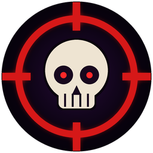

# Personal Vendetta

A hitman list for **World of Warcraft: Forever**. When an enemy player kills you in the open world, Personal Vendetta asks whether to add them to your list. From then on it watches for them, tells you the moment one of them is near, and keeps score.

> **This is not a warning for every enemy around you.** It only tracks players who have killed you, and only the ones you chose to add.



## Features

- **Know who killed you, without popups.** After an open-world death, every enemy player who hit you lands in the **To add** tab of the floating window, so a three-man gank queues all three. Nothing jumps in front of you mid-fight: the tab just glows until you look. Each row has **Scum**, **Note**, **Skip** and **Add**, plus *Add all* / *Skip all*. Nothing is added without a click, so an honourable 1v1 can walk away clean.
- **Add the ones who lost, too.** Survive a fight with an enemy player who came for you and they're queued the same way. If you saw them drop, your kill is counted. Repeat run-ins merge into one row ("Killed you x2"). Or target someone and type `/vendetta add`.
- **Full names.** Forever characters have a first name and a surname, and the list records both, so two players called Willia never get mixed up.
- **Notes.** Write down what someone did, or build it from one-click presets like *Ganked while leveling*, *While low HP*, *During an escort quest* or *3v1*. Open it straight from the floating window, even before you've added them. The note shows when you hover them and in the alert when they're near.
- **Share with your party.** Send your list to party or raid members who also run the addon. They see how many players are new to them and import only those, with no duplicates.
- **Mark the scum.** Tick **Scum** for anyone who killed you dishonourably. Scum get their own horn, sort to the top, and glow red in the window.
- **A radar for your list.** The floating window's **Nearby** tab collapses to a title bar when nobody is around and expands, flashes, and sounds a horn when someone from your list comes into range. It shows their level, race, class, the score between you, and a Note button.
- **Honest levels.** White means read off them just now. Red `??` means they're 10+ levels above you. Grey `47?` is the last level the game showed.
- **Keeps score both ways.** Their kills on you come from the death recap. Your kills on them count whenever you took part (they were your target, or they were on you or your group, or the honor system credited you), whoever landed the killing blow.
- **A skull over their head.** Listed players get a skull above their nameplate; scum get a pulsing red one.
- **No horn spam.** Each player sounds once when they come into range. If they step out and back in, they have to be gone 30 seconds before they sound again, and that timer is per player. You can also keep it quiet in capital cities, and in neutral towns like Gadgetzan and inns: the window still shows who's there, without the horn or chat line.
- **Party alerts.** When you spot someone from your list, groupmates running the addon get a chat line (and a horn, if that player is on their list too).
- **Settle the score.** Draw level with someone who was ahead and you get a "Vendetta settled" banner and fanfare. Kill streaks of 3, 5 and 10 get one too.
- **Player detail.** Click a name in the hit list for everything known about them: score and standing, when you first met, where you last saw them, the levels they've been seen at, and a dated history of kills and deaths.
- **Undo.** Skip, Skip all and Remove show an Undo button for 10 seconds.
- **One list for all your characters** (optional). Turning it on merges this character's list in, adding scores together for anyone on both.
- **Radar dot.** The dot in the window's corner is green when the radar can see and red when enemy nameplates are off; click it to switch them on or off.
- **Settings from the minimap skull.** Left-click opens settings, right-click shows or hides the window, drag to move it. Tabs for General, Window (lock, size, background opacity, auto-hide when quiet), Alerts (separate horns and volumes for normal and scum sightings) and Hit list (search by name, class, race, zone or note, and a sort dropdown: newest, deaths, kills, scum, last seen or name).
- **In your language.** English, German, French, Spanish (incl. Mexican) and Russian.
- **Ignores arenas and battlegrounds.** Duels never count, since a duel doesn't kill you.

## Installation

1. Download the zip from the [latest release](../../releases/latest).
2. Extract it into your AddOns folder so you end up with:
   ```
   World of Warcraft\_forever_\Interface\AddOns\PersonalVendetta\PersonalVendetta.toc
   ```
3. Fully restart the game (not just `/reload`). New addons are only picked up at launch.
4. Make sure **enemy nameplates** are on. The radar sees through them. The settings panel has a tickbox for this, or type `/vendetta nameplates`.

## Commands

| Command | What it does |
| --- | --- |
| `/vendetta` | Show or hide the window |
| `/vendetta review` | Open the window on the To add tab |
| `/vendetta options` | Open settings (or click the minimap skull) |
| `/vendetta list` | Print the list in chat, marking who is near |
| `/vendetta add` | Add your current target |
| `/vendetta add <first> <surname>` / `remove <name>` | Add or take someone off by hand |
| `/vendetta note <name>` | Write a note on someone |
| `/vendetta detail <name>` | Everything known about someone |
| `/vendetta share` | Share your list with your party or raid |
| `/vendetta scum <name>` / `unscum <name>` | Mark or clear scum |
| `/vendetta kill <name>` / `unkill <name>` | Fix your kill count by hand |
| `/vendetta death <name>` / `undeath <name>` | Fix their kill count by hand |
| `/vendetta recap` | Re-read your last death |
| `/vendetta nameplates` | Switch on the enemy nameplates the radar needs |
| `/vendetta range [n]` | Show or raise the nameplate radar range |
| `/vendetta sound` | Toggle the sighting sounds |
| `/vendetta feedback` | Link to leave feedback or report a bug |
| `/vendetta debug` | Show which parts loaded |
| `/vendetta wipe confirm` | Clear the whole list |

`/pv` works as a short form of `/vendetta`.

## How it works, and its limits

WoW: Forever runs on the modern (Midnight) addon API, where the combat log is closed to addons and some combat values are hidden. So Personal Vendetta does not read the combat log at all:

- **Who killed you** comes from the game's own death recap.
- **Who is near** comes from enemy nameplates, plus your target and mouseover. The radar's range is your nameplate range. There is no API to see players beyond it.
- **Your kills** come from watching a list member die while you were fighting them, or from the honor system crediting you.

Known limits:

- If a pet lands the killing blow and its owner never hit you, nobody is offered, because a pet doesn't say who owns it.
- Kill detection reads what the game shows. If one is missed or double-counted, fix it with `/vendetta kill` or `unkill`.
- After a fight, anyone who had you targeted is queued. The game can't say who started it, so skip the ones who don't belong. Skipped players aren't queued again for 30 minutes.
- If two people on your list share a first name, commands need the full name (`/vendetta scum Willia Saqandie`).

## Compatibility

Built for **WoW: Forever** (interface `16001`). It will not load on Classic Era or retail, which use different interface versions and APIs.

## Feedback

Ideas and bug reports are welcome in the [CurseForge comments](https://www.curseforge.com/wow/addons/personal-vendetta-pvp/comments). Translation fixes from native speakers especially.

## Development

The addon lives in [`PersonalVendetta/`](PersonalVendetta). [`tests/`](tests) holds a stub of the game client and a suite that drives the addon's logic through it: deaths, ganks, scum, the radar, hidden values, kill counting, levels, sounds and the settings panel.

```sh
cd tests
lua run.lua        # Lua 5.1 or newer
```

The suite runs outside the game, so it checks logic, not how things look on screen.
